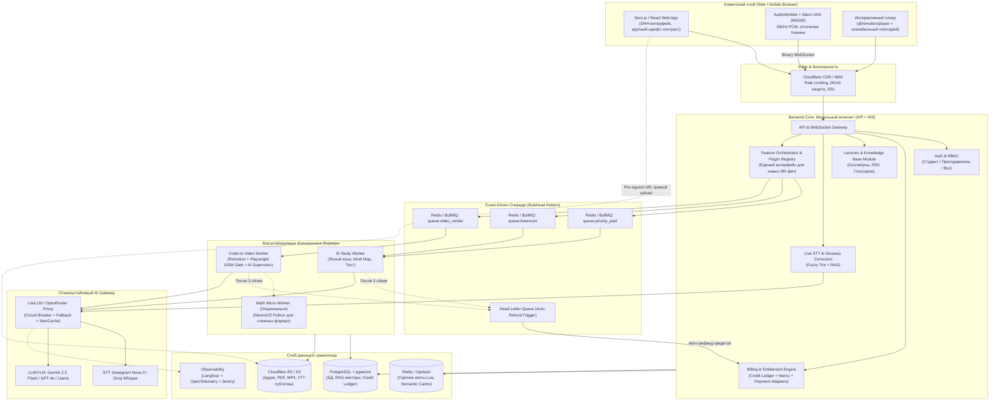
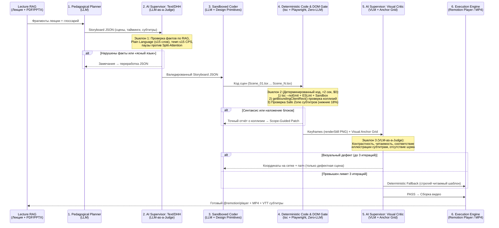

# Архитектура и системный анализ сервиса Lecture AI

**Команда:** ArchAI · **Группа:** АЖиОЗ 25–30  
**Проект:** Lecture AI — живой ИИ-переводчик вузовских лекций в адаптированный конспект, ментальные карты, тесты и code-driven видео-анимации для неслышащих и слабослышащих (Deaf/HoH) студентов  
**Дата:** 22 ноября 2026 г.  

---

## Содержание

1. [Анализ исходных документов и требований экзамена](#1-анализ-исходных-документов-и-требований-экзамена)
2. [Анализ мировых и региональных аналогов (11 сервисов)](#2-анализ-мировых-и-региональных-аналогов-11-сервисов)
3. [Целевая архитектура веб-сервиса (Отказоустойчивость, Масштабирование, Модульность)](#3-целевая-архитектура-веб-сервиса)
4. [Подсистема Real-Time STT и коррекции терминов](#4-подсистема-real-time-stt-и-коррекции-терминов)
5. [Code-Driven Видео-анимация + Контролирующая ИИ-модель (AI Supervisor / Critic)](#5-code-driven-видео-анимация--контролирующая-ии-модель-ai-supervisor--critic)
6. [Гибридная монетизация и архитектура биллинга (Freemium + Pay-Per-Use + Подписка)](#6-гибридная-монетизация-и-архитектура-биллинга)
7. [Бесплатный хостинг для студентов ($0/мес) и путь масштабирования](#7-бесплатный-хостинг-для-студентов-0мес-и-путь-масштабирования)
8. [Риски, этика и соответствие критериям экзамена](#8-риски-этика-и-соответствие-критериям-экзамена)
9. [Дорожная карта под сроки (КТ 2 — Финал) и распределение по ролям команды](#9-дорожная-карта-под-сроки-и-распределение-по-ролям-команды)

---

## 1. Анализ исходных документов и требований экзамена

На основе анализа **Памятки студента**, **Положения об экзаменационном проекте** и **Паспорта команды (КТ 1)** выделены ключевые ограничения и стратегические цели:

### 1.1. Обязательные требования Положения (100-балльная шкала)
| Критерий | Макс. балл | Как архитектура закрывает критерий |
| :--- | :---: | :--- |
| **Применение ИИ** | 20 | ИИ — ядро решения (3+ связанных шага + RAG-база глоссариев и силлабусов + контур AI Supervisor/Critic для контроля качества). |
| **Прототип** | 20 | Публичный веб-сервис по HTTPS-ссылке, работает на реальных данных (не моках) до конца сессии, доступен с ноутбука и смартфона. |
| **Масштаб и сложность** | 15 | Полноценный модульный SaaS: Live STT + Plain Language + Mind Map + Тест + Code-driven видео-анимация + система квот и биллинга. |
| **Презентация и защита** | 15 | Живое демо за 7 минут + резервное демо-видео (2–3 мин). Высокий потенциал отбора в топ 3–4 проекта потока для **AI-Sana**. |
| **Проблема и актуальность** | 10 | Острая социальная проблема (потеря 40–60% материала у Deaf/HoH студентов), подтверждаемая опросом 5+ пользователей и сравнением 11 аналогов. |
| **Тестирование и эффект** | 10 | Тест на 5+ реальных пользователях + измеримый эффект (экономия времени / точность терминов) + прозрачная юнит-экономика. |
| **Документация** | 10 | 11 обязательных разделов (Приложение А, 10–20 стр. PDF) — разделы 3, 5, 6, 8, 9, 10 напрямую опираются на данный документ. |

### 1.2. Критические дедлайны
* **КТ 2 (22 ноября):** Опрос 5+ пользователей, 3+ аналога, **схема системы** *(закрывается этим документом)*.
* **КТ 3 (29 ноября):** Первая работающая версия прототипа (основной сценарий работает вживую).
* **КТ 4 (6 декабря):** Тестирование на 5+ пользователях, список исправлений, черновик документации.
* **Финальная сдача (11 декабря, 23:59):** ZIP-архив до 20 МБ (Документация PDF, Отчёт о вкладе с подписями, Презентация 10–12 слайдов, файл «Паспорт и ссылки» на прототип, демо-видео и GitHub).

> **Архитектурный вывод по КТ 1:** В заявке КТ 1 указан быстрый прототипный стек (Lovable.dev / Bolt.new + Whisper + GPT-4o / Gemini + Supabase). Чтобы успеть к **КТ 3 (29 ноября)** и при этом заложить **отказоустойчивую, масштабируемую архитектуру** с code-driven анимациями, необходимо разделить реализацию на **MVP-ядро (к 29 ноября)** и **целевую Production-архитектуру**, сохранив единый технологический фундамент (TypeScript/React + Next.js + Python/Node воркеры + Supabase/PostgreSQL + Redis).

---

## 2. Анализ мировых и региональных аналогов (11 сервисов)

Мировой рынок разделён на два изолированных сегмента: **Accessibility-сервисы** (дают только сырые субтитры в аудитории) и **AI Study-платформы** (работают только постфактум и ориентированы на слышащих через аудиоподкасты).

### 2.1. Сводная матрица сравнения

| Сервис | Категория | Live ASR на лекции | Глоссарий курса | «Ясный язык» (Deaf/HoH) | Mind Maps | Квизы / Тесты | Видео / Анимации | Языки RU / KZ | Монетизация |
| :--- | :--- | :---: | :---: | :---: | :---: | :---: | :---: | :---: | :--- |
| **Ava** (`ava.me`) | Accessibility | Да (диаризация) | Да | Нет | Нет | Нет | Нет | RU: Да / **KZ: Нет** | Freemium (40 мин) + $10–15/мес + B2B |
| **Otter.ai** | Accessibility / AI | Да | Да (до 800) | Нет | Нет | Нет | Нет | **RU: Нет / KZ: Нет** | Freemium (300 мин) + $8.3–17/мес |
| **Genio (Glean)** | Accessibility Edu | Пост / метки | Нет | Нет | Нет | Нет | Нет | RU: Да / **KZ: Нет** | B2B вузы / ~$12/мес |
| **Google Live Transcribe** | Accessibility | Да (поток) | Нет | Нет | Нет | Нет | Нет | RU: Да / KZ: онлайн | Бесплатно (Android) |
| **Rogervoice** | Accessibility (звонки) | Звонки | Нет | Нет | Нет | Нет | Нет | >100 языков | Госфонд (США) / подписка |
| **Google NotebookLM** | AI Study | **Нет** (постфактум) | Из доков | Нет | **Да** | Частично | **Да** (диффузия Veo) | RU: Да / KZ: огр. | Freemium + AI Plus/Pro ($5–20/мес) |
| **Coconote** | AI Study | Запись (не live-UX) | Нет | Нет | Нет | **Да** | Нет (подкасты) | RU: Да / KZ: слаб. | Paywall ~$10/мес |
| **Turbolearn AI** | AI Study | Запись | Нет | Нет | Нет | **Да** | Нет (подкасты) | RU: Да / **KZ: Нет** | Крошечный Free + $10–20/мес |
| **Mindgrasp** | AI Study | На тарифе Scholar+ | Нет | Нет | Нет | **Да** | Нет | RU: Да / KZ: баз. | Нет Free ($6–11/мес) |
| **Quizlet Plus** | AI Study | Нет | Нет | Нет | Нет | **Да** (лучший) | Нет | RU: Да / KZ: текст | Freemium + $36–45/год |
| **Intelib (SDU / AI-Sana)** | Региональный РК | Нет | Библиотека вуза | Нет | Нет | **Да** | Нет | **RU: Да / KZ: Да** | B2B/B2G вузы РК |
| **Lecture AI (Наш проект)** | **Гибрид: Инклюзия + AI Study** | **Да + Live коррекция** | **Да (RAG силлабус)** | **Да (под ЖЯ)** | **Да** | **Да** | **Да (Code-driven + AI Supervisor)** | **RU + KZ + EN** | **Freemium (все функции) + Pay-Per-Use + Pro + B2B** |

### 2.2. Пять рыночных разрывов (УТП Lecture AI)
1. **Адаптация на «Ясный язык» (Plain Language) для носителей жестового языка:** Для глухих с рождения родным языком является жестовый (РЖЯ/КЖЯ) с иной грамматикой; канцеляризмы и причастные обороты в обычных субтитрах создают когнитивный барьер. Ни один из 11 аналогов не даёт двухуровневый вывод: `[Точный академический термин]` + `[Объяснение на ясном языке]`.
2. **Real-time коррекция терминов по глоссарию и силлабусу курса:** До начала лекции загружается PDF/силлабус дисциплины; ASR-поток корректируется на лету (устраняя ошибки на профильной терминологии и русско-казахско-английском code-switching).
3. **Code-driven видео-анимации вместо диффузионного видео:** В отличие от Google NotebookLM (Veo), где диффузия часто искажает формулы, графики и надписи, генерация анимации **через код** гарантирует 100% точность схем, чёткий текст и дизайн формата *Zero-Audio-First* (всё понятно без звука).
4. **Поддержка RU + KZ + EN code-switching:** Закрывает локальный и региональный рынок Казахстана и СНГ, где Otter, Ava и Genio не поддерживают казахский язык.
5. **Единый цикл «В аудитории → Дома»:** Один веб-сервис заменяет связку *Live Transcribe + NotebookLM + Quizlet*.

---

## 3. Целевая архитектура веб-сервиса

Для команды из 4 человек с требованием **отказоустойчивости, масштабирования под пиковые нагрузки (сессия/поток лекций) и быстрого подключения новых функций** выбран индустриальный паттерн **Модульный монолит (Modular Monolith) + Event-Driven асинхронные воркеры + Plugin Registry**.

> **Почему не микросервисы с первого дня?** Микросервисы для команды из 4 студентов съедают до 50% времени на DevOps и сетевую отладку. Модульный монолит со строгими границами доменов позволяет разрабатывать быстро, а при росте трафика — **выносить любой модуль (например, Video Render или STT Gateway) в отдельный кластер без переписывания бизнес-логики**.

### 3.1. Общая схема системы (System Architecture Diagram)

### 3.2. Механизмы отказоустойчивости (Fault Tolerance) и масштабирования

1. **Изоляция нагрузок (Bulkhead Pattern & Priority Queues):**
   * HTTP-запросы никогда не ждут генерацию конспекта или рендеринг видео. Сервер валидирует квоту, ставит задачу в очередь и мгновенно возвращает `202 Accepted` + `job_id`, а прогресс стримится на клиент через **SSE (Server-Sent Events)**.
   * Очереди разделены: `queue:priority_paid` (платные и разовые покупки) обслуживается раньше `queue:freemium`, а тяжёлый рендеринг (`queue:video_render`) выделен в отдельный пул контейнеров, чтобы рендер видео не тормозил генерацию текстов и live-субтитров.
2. **Отказоустойчивый AI Gateway (Circuit Breaker + Fallback + Semantic Cache):**
   * *Иерархия Fallback:* Если основной провайдер (например, `Gemini 2.5 Flash`) возвращает `429 Rate Limit` или `5xx`, **Circuit Breaker** на 60 секунд переводит его в `OPEN` и мгновенно маршрутизирует запросы на резерв (`GPT-4o-mini` / `Groq Llama` / `OpenRouter`).
   * *Семантический кэш:* Запросы на объяснение типовых терминов векторизуются и ищутся в `Redis/pgvector` (косинусное сходство $\ge 0.95$). Попадание в кэш отвечает за миллисекунды с ценой `$0`.
   * *Прямая передача медиа:* Аудио, PDF-презентации и готовые MP4 загружаются напрямую в объектное хранилище (**Cloudflare R2 / S3**) по **Pre-signed URL**, полностью разгружая API-сервер.
3. **Расширяемость через Plugin Architecture (`LectureFeaturePlugin`):**
   * Каждая AI-функция (Конспект на «ясном языке», Майнд-карта, Мини-тест, Видео-анимация, будущий РЖЯ/КЖЯ-словарь, Карточки Anki) реализует единый контракт:
     * `id`, `quotaKey`, `estimateCost(input)`
     * `inputSchema` / `outputSchema` (Zod / Pydantic)
     * `execute(context, progressCallback)`
   * Единый `FeatureOrchestrator` автоматически берёт на себя проверку прав, резервирование кредитов, ретраи, логирование и рефанд при сбое. Подключение новой функции занимает 1–2 дня без изменения ядра.

---

## 4. Подсистема Real-Time STT и коррекции терминов

Потоковая отправка тишины (паузы преподавателя, шум аудитории) в платные STT API сжигает до 40% бюджета.

### Пайплайн потокового распознавания:
1. **Захват в браузере (`AudioWorklet`):** Передискретизация аудио в `16kHz 16-bit Mono PCM` чанками по `50–100 мс` вне основного потока UI (без фризов интерфейса).
2. **Client-Side Silero VAD (WASM / ONNX Runtime Web):** Детектор голосовой активности работает **прямо в браузере студента**. В WebSocket уходят только сегменты с реальной речью (с буфером `100 мс` до начала речи, чтобы не обрезать первые согласные). Экономия трафика и API — **30–50%**.
3. **Streaming ASR:** Поток уходит в `Deepgram Nova-3` (или `Groq Whisper-large-v3-turbo` чанками по 5–10 сек для бесплатного студенческого прототипа).
4. **Двухуровневая коррекция терминов по глоссарию дисциплины:**
   * *Уровень 1 — Interim-фразы (задержка < 10 мс):* Быстрый локальный поиск в памяти (`Trie / RapidFuzz`) по загруженному словарю терминов предмета (исправление опечаток на лету: *«кубернетес» → «Kubernetes»*, *«транскрипсия» → «транскрипция»*).
   * *Уровень 2 — Final-абзацы (асинхронно каждые 15–30 сек):* Контекстная сверка с векторной базой силлабуса/презентации (RAG) + мгновенное выделение сложных терминов интерактивными кликабельными карточками с объяснением на «ясном языке».
5. **Graceful Degradation (Защита от обрыва Wi-Fi в аудитории):** Если связь пропала, аудио локально буферизируется в `IndexedDB` браузера и при восстановлении сети автоматически догружается в R2 для пакетной расшифровки — студент не потеряет лекцию.

---

## 5. Code-Driven Видео-анимация + Контролирующая ИИ-модель (AI Supervisor / Critic)

Это ключевая инновация **Lecture AI**: система анализирует транскрипт лекции и все приложенные материалы (PDF, PPTX, силлабус) и создаёт **наглядную 2D видео-анимацию / обучающий мультфильм**, реализованную **через детерминированный исполняемый код**, качество которого контролирует специализированная **ИИ-модель (AI Supervisor / Critic)**.

### 5.1. Выбор движка программной анимации

| Критерий | **Remotion** (React + TS) | **ManimCE** (Python) | **Revideo** (TS + Canvas) | **Наш выбор: Hybrid** |
| :--- | :--- | :--- | :--- | :--- |
| **2D-мультфильмы, персонажи, SVG, диалоги, карточки** | Отлично (HTML/CSS/SVG/Lottie) | Слабо (сложно верстать UI) | Хорошо | **Remotion Core** |
| **Субтитры и DHH-доступность** | Отлично (`@remotion/captions`, Flexbox Safe Zones) | Слабо (ручные координаты) | Хорошо | **Remotion Core** |
| **Сложная математика / LaTeX / 3D-графики** | Средне (KaTeX + SVG) | **Лучший в мире** | Средне | **ManimCE** (как отдельный микро-воркер для мат. вставок) |
| **Детерминированная проверка вёрстки** | **Отлично** (DOM `getBoundingClientRect()` без затрат на VLM) | Нет (только глазами VLM) | Частично | **Playwright DOM Gate** |
| **Интерактивный просмотр без нагрузки на сервер** | **Да** (`@remotion/player` прямо в браузере!) | Нет | Нет | **Двойной вывод: `@remotion/player` + экспорт MP4** |
| **Лицензия при коммерческом росте** | Бесплатно до 3 чел. / НКО; для крупного SaaS нужна лицензия Automators | 100% MIT | 100% MIT | Старт на **Remotion** (быстро + `@remotion/player`), при масштабе SaaS — опция миграции рендера на **Revideo (MIT)** |

> **Инженерный лайфхак для студенческого прототипа:** Благодаря `@remotion/player`, 100% анимации (мультфильм с персонажами, схемами, паузами и субтитрами) может воспроизводиться **прямо в браузере пользователя в реальном времени (60 FPS)** с нулевой нагрузкой на сервер, а тяжёлый серверный рендер в **MP4** запускается только по кнопке «Скачать видео»!

### 5.2. Архитектура пайплайна «Исполняемый код + AI Supervisor / Critic»

Основана на лучших мировых практиках 2025–2026 гг. (*Code2Video*, *TheoremExplainAgent*, *Manimator*, *ManimAgent*): разделение ролей на **Педагогический планнер → Детерминированный исполнитель (Код) → 3-эшелонный контроль качества (AI Supervisor + DOM Gate + VLM Critic) → Цикл самоисправления (Reflexion Loop)**.

### 5.3. Как именно настроена контролирующая ИИ-модель (AI Supervisor)

Контролирующая модель не просто «просит переписать код», а работает по жёсткому **3-эшелонному протоколу контроля**:

1. **Эшелон 1 — Text & Accessibility Gate (до генерации кода):**
   * Проверяет `Storyboard JSON` на **фактологическую точность** против `Lecture RAG` (исключает галлюцинации).
   * Проверяет правила доступности для Deaf/HoH: длина фразы $\le 12–15$ слов, скорость субтитров $\le 14–16$ символов/сек (CPS), наличие 2–3-секундных визуальных пауз на сложных диаграммах (борьба со *Split-Attention Effect*, когда глухой студент не успевает одновременно читать субтитры и следить за движением графики).
2. **Эшелон 2 — Deterministic Code & DOM Gate (Zero-LLM, < 2 сек):**
   * Исполняемый код компилируется в изолированном Docker-контейнере (`tsc --noEmit`, ESLint, запрет сетевых/ФС вызовов).
   * Headless Chromium (Playwright) открывает ключевые кадры и математически проверяет `getBoundingClientRect()` всех элементов: пересечение текстовых блоков $= 0$, выход за границы экрана $= 0$, вторжение графики в нижние 18% экрана (зону субтитров) $= 0$. Это отсекает **до 80% типичных визуальных багов LLM бесплатно**.
3. **Эшелон 3 — Visual Supervisor (VLM-as-a-Judge) + Self-Healing Loop:**
   * Делает 3–4 скриншота каждой сцены (`renderStill()`) с наложенной полупрозрачной координатной сеткой (**Visual Anchor Grid**).
   * VLM-модель (`Gemini 2.5 Flash`) оценивает кадры по схеме *Analyze-then-Judge* (контраст WCAG $\ge 4.5:1$, смысловое соответствие графики и текста) и при `FAIL` возвращает **точечный патч** только для проблемной сцены (*Scope-Guided Patching*).
   * **Защита от бесконечного цикла (Anti-Thrashing):** максимум **3 итерации** на сцену. Если за 3 попытки сцена не прошла проверку, система автоматически переключает её на **Deterministic Fallback Template** (гарантированно читаемая карточка + схема + контрастные субтитры).

---

## 6. Гибридная монетизация и архитектура биллинга

Реализована модель **«All-Features Freemium + Pay-Per-Use + Subscription + University B2B»**: бесплатная версия открывает **100% функций** (включая видео-анимацию и live-коррекцию), но регулируется прозрачной системой лимитов/кредитов.

### 6.1. Тарифная сетка (ориентир для РК и глобального рынка)

| Параметр | **Free (Студент)** | **Pay-Per-Use (Разовая оплата)** | **Student Pro (Подписка)** | **University B2B / AI-Sana** |
| :--- | :--- | :--- | :--- | :--- |
| **Цена** | **0 ₸ / $0** | **390 ₸ (~$0.8)** за 1 пакет лекции или **250 ₸** за 1 видео-анимацию | **2 490 ₸/мес (~$4.99)** *(семестр 4 мес — 7 990 ₸)* | Контракт с вузом *(бесплатно для студентов с ОВЗ)* |
| **Доступные функции** | **Все 100% функций** | **Все 100% функций** | **Все 100% функций** | **Все + общие глоссарии кафедр + LMS** |
| **Live-транскрибация + Глоссарий** | 90 мин / мес | +90 мин (1 полная пара) | 1 200 мин / мес (20 часов) | Пул вуза / безлимит |
| **Конспект («Ясный язык») + Mind Map + Тест** | 3 лекции / мес | +1 полный пакет лекции | Безлимит (Fair Use) | Безлимит |
| **Code-driven видео-анимация** | 2 ролика / мес (до 60 сек) | +1 ролик (до 3 мин) + MP4 | 15 роликов / мес + HD MP4 | Настраиваемый пул |
| **Приоритет очереди** | `queue:freemium` | `queue:priority_paid` | `queue:priority_paid` | Выделенный пул |

### 6.2. Архитектура биллинга: Immutable Credit Ledger + Two-Phase Reservation

Чтобы при сбоях ИИ или повторных кликах студент **никогда не терял деньги и лимиты**, используется банковский паттерн **Append-Only Credit Ledger**:

1. **Неизменяемый журнал (`credit_ledger` в PostgreSQL):** Баланс никогда не меняется простым `UPDATE balance = balance - 10`. Каждая операция — отдельная строка с уникальным `idempotency_key` (`SUBSCRIPTION_GRANT`, `PURCHASE_TOPUP`, `RESERVATION`, `SETTLEMENT`, `REFUND`, `EXPIRY`).
2. **Двухфазная транзакция (Reserve → Settle / Auto-Refund):**
   * *До запуска задачи:* Атомарно резервируются кредиты (`RESERVATION -50`).
   * *Успех:* Списывается фактическая стоимость (`SETTLEMENT`), сдача возвращается.
   * *Ошибка ИИ / таймаут рендера:* Обработчик `DLQ` **автоматически** начисляет `REFUND +50`.
3. **Waterfall-порядок списания (Entitlement Engine):**
   * Горячие счётчики проверяются в **Redis через атомарный Lua-скрипт** (исключает гонки запросов).
   * Порядок расходования прав: **1)** Разовый токен `Pay-Per-Use` на конкретную лекцию → **2)** Подписочные/бесплатные квоты с ближайшим сроком сгорания → **3)** Бессрочные купленные пакеты кредитов → **4)** Кампусный пул вуза (`tenant_id`).
4. **Платёжные шлюзы (`Payment Adapter Interface`):**
   * **Казахстан (KZT):** **Kaspi Pay** (мгновенная оплата QR для разовых Pay-Per-Use покупок и семестровых пакетов) + **Freedom Pay / TipTop Pay** (автосписание ежемесячных подписок по картам) + **Webkassa API** (автоматические фискальные чеки ОФД).
   * **Глобальный рынок (USD/EUR):** **Polar.sh** (Merchant of Record с выплатами в Казахстан и автоматическим расчётом мирового НДС/VAT без открытия US LLC) или **Paddle** (для международных B2B-инвойсов вузам). *(Lemon Squeezy не используется, т.к. платформа сворачивается после поглощения Stripe).*

---

## 7. Бесплатный хостинг для студентов ($0/мес) и путь масштабирования

По правилам экзамена прототип должен быть стабильно доступен по публичной веб-ссылке до конца сессии. При выборе бесплатного хостинга в 2025–2026 гг. учтены важные ограничения:
* `Render Free` (512 MB RAM) и `Koyeb Free` (0.1 vCPU) **не потянут** серверный рендер Chromium/FFmpeg (упадут по OOM).
* `Hugging Face Docker Spaces` перевели на платный тариф PRO ($9/мес).

### 7.1. Рекомендуемый «Zero-Cost Student Stack» ($0/мес)

| Слой | **Вариант А (Оптимальный — $0, без карты по студенческой почте / Student Pack)** | **Вариант Б (100% без карты и без Student Pack — $0)** |
| :--- | :--- | :--- |
| **Frontend (Веб-интерфейс + `@remotion/player`)** | **Vercel Hobby** ($0, 100 GB трафика, HTTPS-ссылка `lecture-ai.vercel.app`) | **Vercel Hobby** или **Cloudflare Pages** |
| **Backend API + Video Render Worker** | **Azure for Students** ($100 бесплатно по вузовской почте **без карты** → VM 2 vCPU / 4 GB RAM, 24/7 без сна!) *Альтернативы:* **Oracle Cloud Always Free** (4 OCPU / 24 GB RAM, нужна верификация картой) или **DigitalOcean $200** (GitHub Student Pack) | **Render Free** (только лёгкий API + WebSockets) + **клиентский рендер анимации в браузере через `@remotion/player`** (0 нагрузки на сервер!). Для MP4-экспорта на демо — опциональный локальный воркер через Upstash Redis. |
| **БД + Векторы (`pgvector`) + Auth** | **Supabase Free** (500 MB Postgres + `pgvector` + Auth 50k MAU, без карты) или **Neon Free** (1 GB + выход из сна за <1 с) | **Supabase Free** + **Neon Free** |
| **Очереди и кэш** | **Upstash Redis Free** (500 000 команд/мес, без карты) | **Upstash Redis Free** |
| **Хранилище файлов (PDF/Аудио/MP4)** | **Cloudflare R2** (10 GB бесплатно, **$0 за трафик**) или Supabase Storage (1 GB без карты) | **Supabase Storage** (1 GB без карты) |
| **AI API (STT + LLM + VLM)** | • **Deepgram**: **$200 бесплатных кредитов** (без карты!) — идеальный live WebSocket STT • **Groq Free**: `whisper-large-v3-turbo` (до 8 ч аудио/день) + Llama • **Google Gemini 2.5 Flash Free**: 250k TPM — основной LLM + VLM Supervisor | То же самое (**$0**, карта не требуется ни для Deepgram $200, ни для Groq, ни для Gemini AI Studio!) |

### 7.2. План масштабирования (Scale-Up Production Stack при росте до 10 000+ пользователей)

При выходе на коммерцию или внедрении в вузы (AI-Sana) стек бесшовно масштабируется за **~$20–35/мес** без переписывания кода:
* **Frontend:** `Cloudflare Workers Paid` ($5/мес) или `Vercel Pro` ($20/мес).
* **API + Воркеры:** `Hetzner Cloud` (€7–15/мес, 8–16 GB RAM, 20 TB трафика) + автоскейлинг тяжёлого рендера видео на **Modal** (посекундная оплата CPU/GPU, первые **$30/мес бесплатно**).
* **БД и Хранилище:** `Supabase Pro` ($25/мес) или `Neon Launch` + `Cloudflare R2` ($0.015/GB, $0 egress).
* **AI API:** Переход на Paid Tier Gemini / Deepgram / Groq (снимает лимиты RPM и юридически гарантирует, что данные студентов не используются для обучения моделей).

---

## 8. Риски, этика и соответствие критериям экзамена

*(Готовая база для Раздела 9 «Риски и этика» экзаменационной документации)*

| Категория риска | Описание угрозы | Архитектурная мера защиты (Mitigation) |
| :--- | :--- | :--- |
| **Галлюцинации ИИ** | ИИ может исказить научное определение или формулу в конспекте/анимации. | Строгий RAG-grounding по загруженному силлабусу/учебнику + Эшелон 1 AI Supervisor (проверка фактов с цитированием источника) + пометка «Проверено по материалу курса». |
| **Визуальная нечитаемость анимации** | Наложение текста, мелкий шрифт, быстрые субтитры (Split-Attention у Deaf/HoH). | Детерминированный DOM Collision Gate (`getBoundingClientRect()`) + VLM Critic + лимит $\le 15$ CPS + Fallback-шаблон после 3 неудачных итераций. |
| **Персональные данные и авторское право** | Запись голоса преподавателя без согласия; использование данных студентов в Free AI API. | Предупреждение о согласии преподавателя перед записью; хранение аудио по умолчанию в режиме *ephemeral* (удаление аудио после транскрибации, хранится только текст); в Production — только Paid API с Zero Data Retention (ZDR). |
| **Предвзятость (Bias) и языковое неравенство** | Худшее качество распознавания акцентов и казахской академической речи. | Использование мультиязычных моделей (`Deepgram Nova-3` / `Whisper v3`) + обязательный пользовательский глоссарий дисциплины (RU/KZ/EN) + кнопка «Сообщить об ошибке термина» для дообучения словаря. |
| **Наплыв пользователей (Сессия)** | Пик нагрузок в декабре/мае кладёт сервер и исчерпывает лимиты AI API. | Приоритетные очереди (Bulkhead), клиентский `@remotion/player` (0 нагрузки на сервер), Semantic Cache, Circuit Breaker и авто-переключение между провайдерами ИИ. |

---

## 9. Дорожная карта под сроки и распределение по ролям команды

С учётом дедлайнов **КТ 3 (29 ноября)** и **Финальной сдачи (11 декабря)** рекомендуется итеративная сборка:

### 9.1. Этапы разработки
* **Этап 1 — КТ 2 (до 22 ноября, сегодня):**
  * Зафиксировать схему системы (из Раздела 3 и 5 этого документа) и таблицу аналогов (из Раздела 2).
  * Завершить опрос 5+ целевых пользователей и приложить паспорт команды на первую страницу отчёта КТ 2.
* **Этап 2 — КТ 3: Рабочий прототип (23–29 ноября):**
  * Деплой веб-приложения на **Vercel Hobby** + БД/Auth на **Supabase Free**.
  * Реализация сквозного сценария:
    1. Загрузка силлабуса/глоссария (PDF/текст).
    2. Живая транскрибация (Deepgram $200 / Groq Whisper + AudioWorklet) с коррекцией терминов.
    3. Генерация конспекта на «ясном языке», Mind Map (Mermaid/ReactFlow) и мини-теста (Gemini 2.5 Flash).
    4. Генерация code-driven видео-анимации (Storyboard JSON → AI Supervisor → `@remotion/player` прямо в браузере!).
    5. Базовый счётчик лимитов Free-тарифа + экран выбора Pay-Per-Use / Student Pro (демо-оплата).
* **Этап 3 — КТ 4: Тестирование и доработка (30 ноября – 6 декабря):**
  * Подключение серверного рендера MP4 (Azure for Students / Oracle Free) и DOM Collision Gate.
  * Тестирование прототипа на **5+ реальных пользователях** (с фиксацией метрик: точность терминов до/после глоссария, понятность «ясного языка», удобство анимации).
  * Сборка черновика документации (10–20 стр. PDF по Приложению А).
* **Этап 4 — Финальная сдача (7–11 декабря, до 23:59):**
  * Финальный PDF документации, Отчёт о вкладе с взаимной оценкой и подписями, Презентация (10–12 слайдов на 7 мин), Демо-видео (2–3 мин по открытой ссылке), ZIP-архив $\le 20$ МБ и проверка публичной ссылки прототипа с чужого устройства.

### 9.2. Матрица ответственности команды ArchAI (по Паспорту)

| Участник | Роль | Зона ответственности в новой архитектуре |
| :--- | :--- | :--- |
| **Әділхан Адель Асылбекқызы** *(Капитан)* | Руководитель проекта | Опрос 5+ пользователей, юнит-экономика и тарифная модель (Freemium/Pay-Per-Use/B2B), разделы 1–3, 8–10 документации, отчёт о вкладе, финальная сборка ZIP и сдача на портал. |
| **Худайбергенова Арайлым Атабековна** | Разработчик прототипа | Сборка Next.js/React веб-приложения, интеграция `AudioWorklet` + STT, `@remotion/player` (code-driven анимация), Supabase БД/лимиты/квоты, деплой на Vercel + Azure/Render, GitHub-репозиторий и инструкция по запуску (разделы 4, 6). |
| **Есенжан Тоқжан Темірланқызы** | ИИ-инженер и аналитик данных | Настройка AI Gateway (Gemini 2.5 Flash + Groq/Deepgram), база знаний (глоссарии + RAG), системные промпты для «Ясного языка», **Pedagogical Planner** и **AI Supervisor/Critic** (валидация фактов, DHH-правил и визуального кода), тестирование на 5+ пользователях (разделы 5, 7). |
| **Шерадзе Лейла** | Дизайнер и спикер | Инклюзивный DHH UI/UX (WCAG AAA контраст, крупная типографика, цветовые акценты, карточки терминов), библиотека визуальных SVG-компонентов для Remotion-мультфильмов, презентация (10–12 слайдов), демо-видео (2–3 мин) и речь к защите. |
