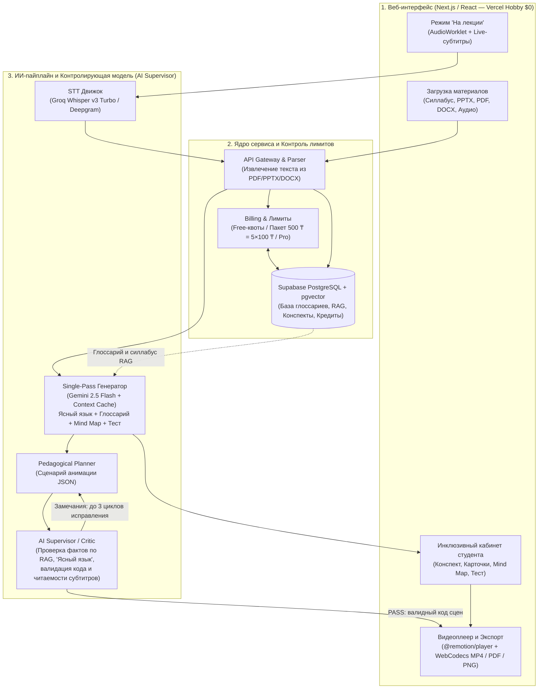

# Контрольная точка 2 (КТ 2). Исследование и схема системы

**Дисциплина:** Основы искусственного интеллекта  
**Дата:** 22 ноября 2026 г.  

---

## Паспорт команды

**Название команды:** ArchAI · **Группа:** АЖиОЗ 25–30  
**Название проекта:** Lecture AI — ИИ-сервис адаптации вузовских лекций и учебных материалов в конспект на «ясном языке», ментальную карту, тест и обучающую видео-анимацию для неслышащих и слабослышащих студентов  
**Направление:** Актуальная проблема  

| № | ФИО полностью, как в портале | Роль в команде | За что отвечает | Капитан (да/нет) |
| :-: | :--- | :--- | :--- | :-: |
| 1 | Әділхан Адель Асылбекқызы | Руководитель проекта | Постановка проблемы и описание целевого пользователя, план работ и контроль сроков, проведение интервью/опроса 5+ пользователей, анализ аналогов; подготовка разделов 1–3, 8–10 документации и сводного отчёта о вкладе участников. | **да** |
| 2 | Худайбергенова Арайлым Атабековна | Разработчик прототипа | Сборка работающего веб-приложения Lecture AI: загрузка материалов (PDF/PPTX/силлабус), живая транскрибация речи (Speech-to-Text), всплывающие карточки терминов, генерация майнд-карты, мини-теста и проигрывателя/экспорта видео-анимации; публикация сайта, GitHub и инструкция по запуску (разделы 4 и 6 документации). | нет |
| 3 | Есенжан Тоқжан Темірланқызы | ИИ-инженер и аналитик данных | Выбор и подключение ИИ-моделей (Groq Whisper / Deepgram, Gemini 2.5 Flash), сбор базы знаний (глоссарий терминов и силлабусы), системные промпты для «ясного языка» и контролирующей модели AI Supervisor/Critic, проверка качества ответов ИИ и тестирование прототипа на 5+ пользователях (разделы 5 и 7 документации). | нет |
| 4 | Шерадзе Лейла | Дизайнер и спикер | Проектирование инклюзивного визуального интерфейса (крупная типографика, высокий контраст, карточки и схемы), дизайн шаблонов видео-анимаций, вёрстка презентации (10–12 слайдов), запись демо-видео (2–3 минуты) и подготовка речи команды к защите. | нет |

---

## 1. Опрос и интервью будущих пользователей (5 респондентов)

Для подтверждения актуальности проблемы было проведено онлайн-исследование **«Восприятие лекций и терминологии (Lecture AI)»** (20–22 ноября 2026 г.). В опросе приняли участие **5 студентов** из **4 ведущих вузов Казахстана** (**КазГАСА**, **ЕНУ**, **AlmaU**, **КазНУ**), включая целевого пользователя с нарушением слуха.

### 1.1. Вопросы проведённого опроса
1. Возраст, статус и учебное заведение / специальность.
2. Сталкиваетесь ли вы с трудностями при восприятии устной речи лектора?
3. Какая доля информации на обычной устной лекции теряется или остаётся непонятной? *(шкала от 1 до 5)*
4. Как вы сейчас решаете проблему записи и понимания сложных лекций?
5. Что вас не устраивает в стандартных автосубтитрах и сервисах распознавания речи?
6. Насколько полезна функция перевода сложных научных фраз на «ясный язык» (короткие понятные формулировки)?
7. Какие функции в приложении Lecture AI были бы для вас самыми важными?
8. Расскажите в 1–2 предложениях о самой частой проблеме на лекциях или пожелании к сервису.

### 1.2. Сводная таблица реальных ответов (5 респондентов)

| № | Респондент (вуз, курс, специальность, статус) | Потери (1–5) | Как решает проблему сейчас | Что не устраивает в автосубтитрах | Оценка функции «Ясный язык» | Выбранные функции Lecture AI | Пожелание / цитата |
| :-: | :--- | :-: | :--- | :--- | :--- | :--- | :--- |
| 1 | 18 лет, 2 курс, **КазГАСА**, Архитектура *(нужен удобный автоконспект)* | 1 | Включает стандартные автосубтитры (телефон, Zoom, YouTube) | Слишком длинный сплошной текст без структуры — тяжело читать на лету | Полезна, но важно сохранять и оригинальный термин для экзамена | Мини-тест из 5 вопросов для самопроверки | *«Чтобы на лекции не было воды»* |
| 2 | 18 лет, 2 курс, **КазГАСА**, Архитектура *(нужен удобный автоконспект)* | 3 | Ищет информацию самостоятельно в учебниках и интернете | Длинный сплошной текст без структуры; не объясняют сложные научные и канцелярские обороты | Полезна, но важно сохранять и оригинальный термин для экзамена | Live-субтитры по силлабусу, карточки терминов, майнд-карта, мини-тест, крупный шрифт и акценты | *«Недостаточно понятное объяснение сложных тем и нехватка времени на вопросы. Хотелось бы больше обратной связи и интерактива»* |
| 3 | 19 лет, 2 курс, **ЕНУ**, Переводческое дело *(нужен удобный автоконспект)* | 3 | Включает стандартные автосубтитры (телефон, Zoom, YouTube) | Большая задержка при переводе речи в текст | Полезна, но важно сохранять и оригинальный термин для экзамена | Автоматическая майнд-карта, мини-тест из 5 вопросов | — |
| 4 | 19 лет, 2 курс, **AlmaU**, Бизнес-администрирование *(**есть нарушение слуха** — полное или частичное)* | 3 | **Сурдопереводчик / ЖЯ**, стандартные автосубтитры, запись на диктофон, учебники и интернет | Длинный сплошной текст без структуры; не объясняют сложные научные и канцелярские обороты | Полезна, но важно сохранять и оригинальный термин для экзамена | Live-субтитры по силлабусу, карточки терминов, майнд-карта, крупный шрифт и цветовые акценты | *«**Больше визуального объяснения лекции**»* |
| 5 | 21 год, 2 курс, **КазНУ** *(нужен удобный автоконспект)* | 1 | Ищет информацию самостоятельно в учебниках и интернете | Не объясняют сложные научные и канцелярские обороты | **Очень полезна** — сложные формулировки сильно тормозят понимание | Всплывающие карточки с простым объяснением терминов | *«Все понятно и доступно»* |

### 1.3. Ключевые выводы исследования в цифрах
* **Подтверждение боли целевой аудитории:** Респондент с нарушением слуха (AlmaU) вынужден одновременно использовать **4 разных способа** (сурдопереводчик, автосубтитры, диктофон и самостоятельный поиск в учебниках), но всё равно оценивает потери материала на **`3 из 5`** (как и **60% (3 из 5)** всех опрошенных).
* **Две главные проблемы существующих автосубтитров:**
  * **60% (3 из 5)** — *«Слишком длинный сплошной текст без структуры — тяжело читать на лету»*;
  * **60% (3 из 5)** — *«Не объясняют сложные научные и канцелярские обороты»*.
* **100% востребованность «Ясного языка»:** **Все 5 из 5 (100%)** респондентов подтвердили необходимость перевода сложных научных фраз на «ясный язык» (из них **80%** подчеркнули важность сохранения оригинального термина для подготовки к экзамену, а **20%** отметили, что сложные формулировки сильно тормозят понимание). Это обосновало двухуровневый интерфейс: **оригинальный термин + всплывающая карточка с простым объяснением**.
* **Топ-3 функции по выбору студентов:**
  1. **Всплывающие карточки с простым объяснением терминов** — **60% (3 из 5)**;
  2. **Автоматическая майнд-карта (схема) темы** — **60% (3 из 5)**;
  3. **Мини-тест из 5 вопросов для самопроверки** — **60% (3 из 5)**;
  4. Живые субтитры по силлабусу курса и крупный шрифт с цветовыми акцентами — **40% (2 из 5)**.
* **Главный продуктовый инсайт опроса:** Прямой запрос студента с нарушением слуха (*«Больше визуального объяснения лекции»*) в сочетании с запросами на *«интерактив»* и *«доступность без воды»* привёл к расширению архитектуры Lecture AI: мы добавили **генерацию обучающей 2D видео-анимации (мультфильма) по всем загруженным материалам преподавателя**.

---

## 2. Анализ аналогов (5 мировых и региональных решений)

Для исследования были проанализированы 5 ключевых аналогов из двух сегментов: инклюзивные ассистивные инструменты (`Ava`, `Genio`) и современные ИИ-платформы для учёбы (`Google NotebookLM`, `Coconote / Turbolearn AI`, а также казахстанский университетский проект `Intelib`).

### 2.1. Сравнительная таблица аналогов

| Критерий | **Ava** (`ava.me`) | **Genio** (ранее Glean) | **Google NotebookLM** | **Coconote / Turbolearn AI** | **Intelib** (SDU / AI-Sana, РК) | **Lecture AI** *(наш проект)* |
| :--- | :--- | :--- | :--- | :--- | :--- | :--- |
| **Категория** | Live-субтитры для глухих | Конспектирование для студентов с ОВЗ | ИИ-студия по загруженным файлам | ИИ-конспектер лекций | Библиотечный ИИ для вузов РК | **Инклюзивный ИИ-переводчик и визуализатор лекций** |
| **Загрузка файлов преподавателя (силлабус, PPTX, PDF)** | Нет (только список слов) | Слайды + аудио | Да (PDF, Docs, аудио) | Да (PDF, аудио, YouTube) | База учебников вуза | **Да (весь пакет файлов + силлабус + аудио/текст)** |
| **Live-субтитры с коррекцией терминов** | Да (диаризация + словарь) | Постобработка и метки | Нет | Только запись (без live-UX) | Нет | **Да (режим «На лекции» + словарь курса)** |
| **Адаптация на «Ясный язык» (под носителей ЖЯ)** | Нет | Нет | Нет | Нет | Нет | **Да (короткие фразы + кликабельные карточки терминов)** |
| **Майнд-карта и мини-тест** | Нет | Нет | Mind Map (да), тест (частично) | Тест (да), Mind Map (нет) | Тест (да) | **Да (оба артефакта + скачивание PDF/PNG)** |
| **Обучающая видео-анимация** | Нет | Нет | Да, но через диффузию (Veo) — возможны ошибки в формулах | Нет (только аудиоподкасты) | Нет | **Да: Code-driven 2D-анимация + контроль AI Supervisor + скачивание** |
| **Поддержка языков (RU / KZ)** | RU: Да / **KZ: Нет** | RU: Да / **KZ: Нет** | RU: Да / KZ: огр. | RU: Да / **KZ: слабая** | **RU: Да / KZ: Да** | **RU + KZ + EN (включая code-switching)** |
| **Цена для студента (в тенге, ~460 ₸/\$)** | Free (40 мин) / **~4 600–6 900 ₸/мес** | **~5 500 ₸/мес** или через вуз | Free (лимиты) / **~2 300–9 200 ₸/мес** | **~4 600–9 200 ₸/мес** (жёсткий paywall) | Только B2B вузы | **Free (все функции с лимитом) / 100 ₸ за генерацию (пакет 500 ₸) / B2B вузы** |

### 2.2. Чем Lecture AI лучше аналогов и обычных чат-ботов (ChatGPT / Gemini)
1. **Уникальная адаптация на «Ясный язык»:** Ни один из 5 аналогов не переводит сложный академический текст в формат, адаптированный под носителей жестового языка (короткие предложения, активный залог, кликабельные карточки терминов со ссылками на силлабус).
2. **Точная Code-Driven видео-анимация под контролем AI Supervisor:** В отличие от диффузионного видео (как в NotebookLM), анимация строится **через исполняемый код** (Remotion), а отдельная контролирующая модель (**AI Supervisor**) проверяет факты по загруженным файлам, читаемость и отсутствие наложения субтитров. Готовое видео можно **скачать**.
3. **Поддержка RU + KZ + EN и доступность в Казахстане:** Западные лидеры (`Ava`, `Genio`, `Otter`) не поддерживают казахский язык и стоят 4 600–9 200 ₸/мес. Наша модель с ценой **100 ₸ за генерацию** (через Kaspi QR) в 6–10 раз доступнее и позволяет субсидировать бесплатный доступ для глухих студентов.
4. **Экономия токенов ИИ в 4,75 раза по сравнению с ручными промптами:** Вместо 5 повторных запросов в ChatGPT (где вся лекция перечитывается 5 раз — ~153 800 токенов) наш пайплайн использует **Single-Pass Structured JSON** и **Context Caching** (~32 400 токенов), что снижает себестоимость обработки до **~14 ₸**.

---

## 3. Схема работы системы и сценарий пользователя

### 3.1. Основной сценарий пользователя (по шагам)
1. **Загрузка материалов курса:** Студент загружает файлы, которые дал преподаватель — **силлабус, презентации (PPTX/PDF), раздаточные материалы (DOCX/TXT)**, а также при желании текст или аудиозапись лекции.
   * *Дополнительный режим («На лекции»):* студент может включить живые субтитры в аудитории (Speech-to-Text с автокоррекцией по глоссарию), текст которых автоматически добавляется к материалам пары.
2. **Единый ИИ-анализ (по кнопке «Создать учебный пакет»):** Система извлекает текст и структуру файлов, индексирует базу терминов курса (`RAG / pgvector`) и за 1 оптимизированный проход формирует структурированные данные.
3. **Контур контроля качества (AI Supervisor / Critic):**
   * *Проверка текста и фактов:* контролирующая ИИ-модель сверяет конспект и сценарий мультфильма с исходными файлами преподавателя (защита от галлюцинаций) и проверяет правила «ясного языка» и скорости субтитров ($\le 15$ символов/сек).
   * *Проверка кода анимации:* движок проверяет корректность кода и отсутствие перекрытия текста с зоной субтитров (до 3 циклов самоисправления + безопасный Fallback-шаблон).
4. **Выдача и скачивание результатов:** Студент получает в едином инклюзивном интерфейсе 4 связанных инструмента — каждый можно **скачать**:
   * Адаптированный конспект на «ясном языке» с кликабельными терминами (**экспорт в PDF**);
   * Интерактивная майнд-карта темы (**экспорт в PNG / SVG**);
   * Интерактивный мини-тест из 5+ вопросов с разбором ошибок (**экспорт в PDF**);
   * Обучающая 2D видео-анимация / мультфильм с субтитрами (**воспроизведение в браузере + скачивание видеофайла MP4/WebM и субтитров SRT**).

### 3.2. Архитектурная схема системы (System Architecture)

### 3.3. Технологический стек прототипа (\$0) и масштабирование
* **Для экзаменационного прототипа (\$0/мес, без привязки банковской карты):**
  * **Фронтенд и API:** `Next.js (React + TypeScript)` на **Vercel Hobby** (публичная HTTPS-ссылка, работает 24/7 без сна).
  * **База данных, авторизация и RAG-поиск:** **Supabase Free** (`PostgreSQL + pgvector + Auth`).
  * **ИИ-модели:** **Google Gemini 2.5 Flash** (AI Studio Free — основной генератор и AI Supervisor) + **Groq API Free** (`whisper-large-v3-turbo` для аудио).
  * **Видео-анимация и скачивание:** **Remotion (`@remotion/player`)** + клиентский экспорт видео (**WebCodecs / MediaRecorder**) и документов (**PDF / PNG**) прямо в браузере (0 нагрузки на сервер).
* **План масштабирования (для высокой нагрузки и коммерческого запуска):**
  * Подключение очередей **Redis / BullMQ** (разделение платного и бесплатного трафика), **Circuit Breaker + Fallback** между LLM-провайдерами, серверного рендера HD MP4 (через **Modal / Hetzner**), хранения видео в **Cloudflare R2** и оплаты через **Kaspi Pay QR** (комиссия 0,95% позволяет окупать сервис при цене **100 ₸ за генерацию** уже от ~70–100 платящих студентов).
